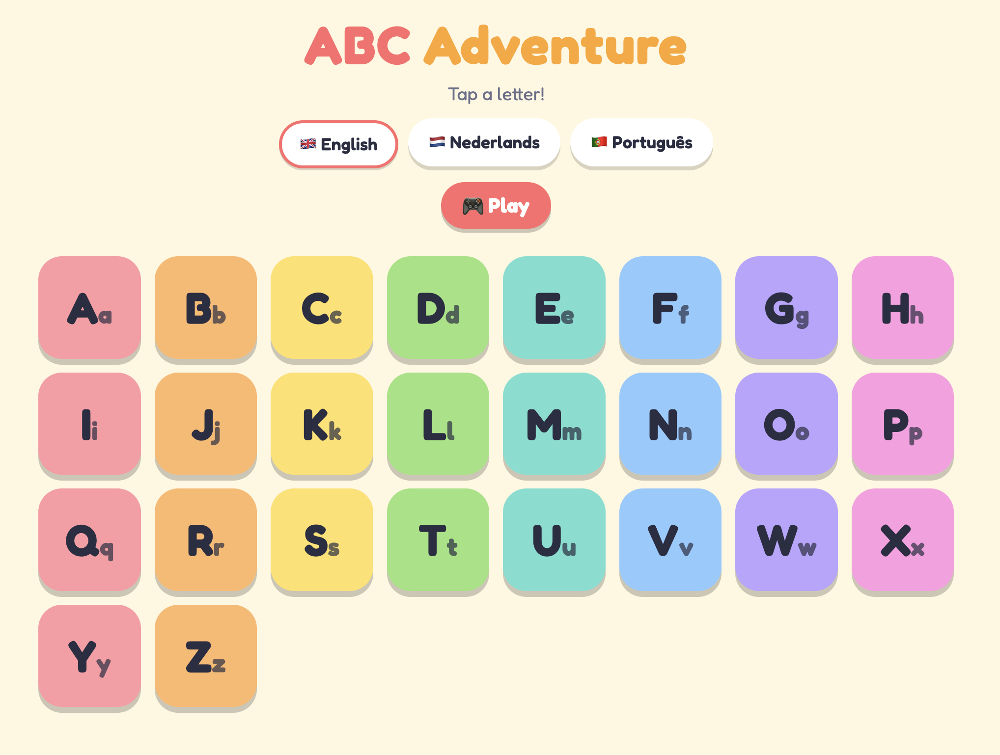

# ABC Adventure

A kid-friendly alphabet app (React + Vite). Tap a letter to see example words; tap a word to hear it.
Languages included: English, Dutch, Portuguese.

## Run it

Requires Node.js 18 or newer.

    npm install
    npm run dev        # development server with live reload
    npm run build      # production build in dist/
    npm run preview    # preview the production build

Upload the contents of `dist/` to any static host (Netlify, Vercel, GitHub Pages...).

## Change the content

Everything is in `src/data/alphabet.json`:

- **Add a language:** copy one block inside `languages`, give it a new key (e.g. `"es"`), and set
  `name`, `flag`, `speech` (voice code such as `es-ES`), `ui` texts and `words`.
- **Add or remove letters:** edit the keys of `words` (Ñ, Ç, etc. work too).
- **Words** are `["Word", "emoji"]` pairs. Any number per letter.

## Structure

    src/
      App.jsx                  state: language + selected letter
      data/alphabet.json       all content
      components/              LanguagePicker, LetterGrid, LetterPanel, WordCard
      lib/speak.js             read-aloud helper
      lib/colors.js            tile and card colors
      styles/app.css           design (light + dark mode)

Keyboard: Esc closes the letter panel, left/right arrows move between letters.

## Game: "Find the letter"

Press **Play** under the language buttons. The app says a letter out loud and the child taps the
matching tile (10 rounds, 3 choices). Wrong taps fade the tile; after two misses the right tile pulses.
Game texts are in the `ui` block of each language in `alphabet.json`. Game logic is in `src/lib/game.js`
(change `rounds` / `choices` in `Game.jsx` to adjust length and difficulty).

See **LOGGING.md** for how logging works and how to switch log levels on and off.

## Publish on GitHub Pages

The workflow in `.github/workflows/deploy.yml` builds the project and publishes the `dist` folder.

1. Push this project to a GitHub repository (default branch `main`).
2. In the repository go to **Settings > Pages** and set **Source** to **GitHub Actions** (one time only).
3. Push to `main`. Open the **Actions** tab to follow the run; when it is green, the site is live at
   `https://marcusberro.github.io/abc-adventure/`.

Pull requests only run the build as a check. You can also start a deploy by hand: Actions > "Build and
deploy to GitHub Pages" > **Run workflow**. Tip: run `npm install` once locally and commit
`package-lock.json`; the workflow then uses the faster, exact `npm ci`.
